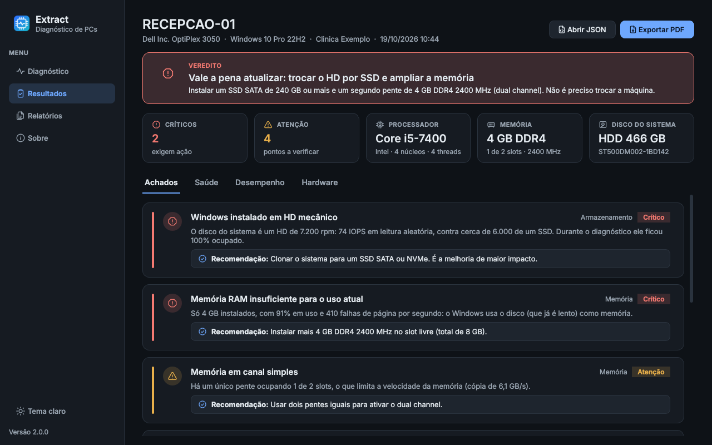
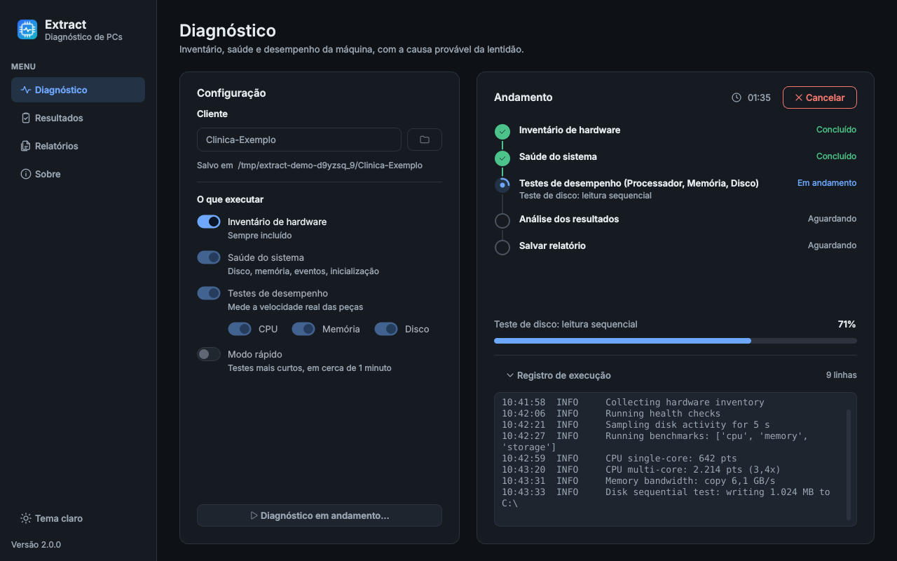
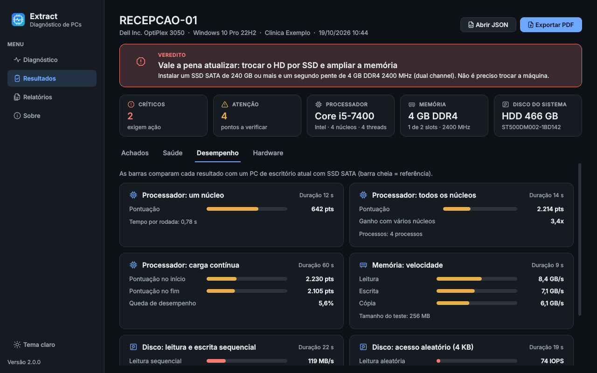
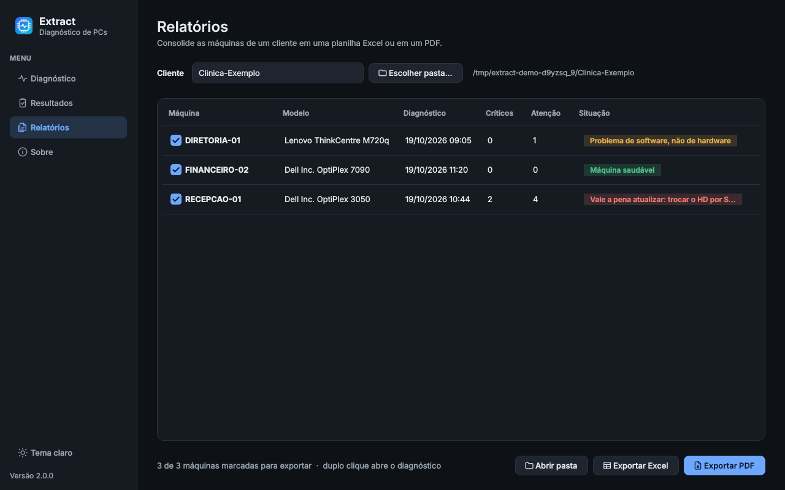
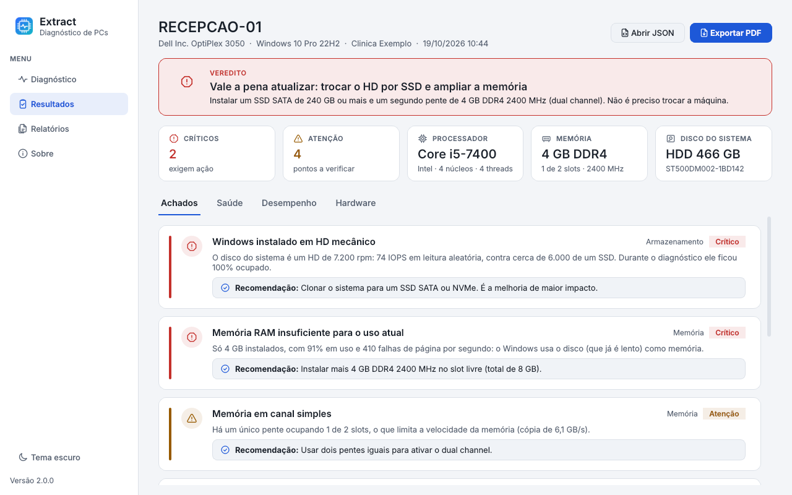

# Extract

**Descubra por que um PC com Windows está lento, e o que fazer, em poucos minutos a partir de um pendrive.**

[](https://github.com/Bredollin/Extract/actions/workflows/ci.yml)


[](LICENSE)

[Read in English](README.md)



O Extract faz o inventário do hardware, verifica a saúde do Windows, mede o desempenho do
processador, da memória e do disco e transforma tudo isso em uma lista curta de achados, em
ordem de gravidade, com um veredito: fazer upgrade de uma peça, corrigir o software, olhar a
rede ou trocar a máquina.

> O aplicativo e os relatórios são em português do Brasil. O código, os comentários e a
> documentação técnica são em inglês.

## Por quê

Trabalho como técnico de informática. O chamado mais comum é alguma versão de *"o computador
está lento"*, *"está travando"* ou *"nada abre"*. A causa costuma ser uma de poucas coisas
(Windows em HD mecânico, 4 GB de RAM, disco falhando, processador perdendo velocidade por
causa de poeira, programas demais na inicialização, rede ruim), mas provar qual delas leva
tempo, e o cliente quer uma resposta clara: *vale a pena fazer upgrade ou é melhor comprar
outra máquina?*

O Extract automatiza essa investigação. Roda no PC do cliente sem instalação, mede em vez de
adivinhar e gera um relatório que posso entregar ao cliente com a evidência por trás de cada
recomendação.

## Funcionalidades

- **Inventário de hardware**: sistema, processador, pentes e slots de memória, placa-mãe,
  placa de vídeo, discos e volumes, adaptadores de rede (via CIM/WMI e `ctypes`).
- **Verificações de saúde**: saúde e espaço livre dos discos, atividade de disco, pressão de
  memória, uso do processador e processos que mais consomem, programas na inicialização,
  erros no log de eventos (disco, WHEA, travamentos, desligamentos inesperados), tempo ligado
  e reinicialização pendente, plano de energia, antivírus, dispositivos com problema,
  conectividade de rede e sinal do Wi-Fi.
- **Testes de desempenho**: processador em um núcleo, em todos os núcleos e sob carga
  contínua (detecta perda de velocidade por temperatura), velocidade da memória, disco
  sequencial e aleatório de 4 KiB sem o cache do Windows. O modo completo leva de 1,5 a
  2 minutos; o modo rápido, de 15 a 25 segundos.
- **Análise da causa e veredito**: 26 regras cruzam inventário, saúde e testes e geram
  achados ordenados por gravidade, cada um com a evidência e uma recomendação. O veredito
  resume tudo: trocar a máquina, corrigir um defeito de hardware antes, fazer upgrade
  (indicando as peças), problema de software, problema de rede ou nenhum gargalo encontrado.
- **Relatórios**: um arquivo JSON por diagnóstico, consolidado por cliente em uma planilha
  Excel e um PDF, para comparar lado a lado as máquinas de um mesmo cliente.
- **Portátil**: um único `Extract.exe`, sem instalação. Relatórios e configurações
  (`extract.ini`) ficam ao lado do exe, no pendrive; nada vai para o registro e nenhum arquivo
  de log é gravado no PC do cliente.
- **Somente leitura, sem administrador**: nunca altera configurações do sistema. Sem direitos
  de administrador alguns contadores SMART ficam indisponíveis, e o relatório avisa.
- **Aplicativo e linha de comando**: interface em PySide6 com tema escuro e claro, e o
  comando `extract-cli` para uso em scripts.

### Telas

| Diagnóstico em andamento | Desempenho |
|---|---|
|  |  |
| **Relatórios do cliente** | **Tema claro** |
|  |  |

As telas usam os dados de demonstração embutidos (máquinas fictícias).

## Como usar

1. Baixe o `Extract.exe` na página de
   [Releases](https://github.com/Bredollin/Extract/releases) e copie para um pendrive.
2. No PC do cliente, execute o `Extract.exe` direto do pendrive. Não precisa instalar nada
   nem ter Python.
3. Digite o nome do cliente, escolha o que executar e inicie o diagnóstico.
4. Os relatórios ficam em `Relatorios\<cliente>\`, ao lado do exe. Na página **Relatórios**
   dá para exportar as máquinas do cliente para Excel ou PDF.

Se a pasta do exe não aceitar gravação (pendrive protegido, pasta de rede), os relatórios vão
para `Documentos\Extract`.

> **Windows SmartScreen**: o exe ainda não tem assinatura digital, então o Windows pode
> mostrar *"O Windows protegeu o computador"*. Clique em **Mais informações → Executar assim
> mesmo**. Se preferir, gere o exe a partir do código (veja [Gerar o exe](#gerar-o-exe)).

## Linha de comando

A CLI é instalada como `extract-cli` (ou use `python -m extract scan ...`).

```console
# Diagnóstico completo; salva JSON, Excel e PDF em reports/<cliente>
extract-cli scan --client "Clinica Exemplo"

# Testes rápidos e pasta de saída escolhida
extract-cli scan --client "Clinica Exemplo" --quick --output D:\Relatorios\Clinica

# Só o teste de disco, sem verificações de saúde, só o JSON
extract-cli scan --only storage --no-health --json-only

# Só inventário e saúde, sem testes de desempenho
extract-cli scan --no-benchmarks

# Gerar Excel e PDF de novo a partir de uma pasta de JSON
extract-cli export reports/Clinica-Exemplo
extract-cli export reports/Clinica-Exemplo --excel resumo.xlsx --pdf resumo.pdf
```

| Opção | Significado |
|---|---|
| `--client NOME` | nome do cliente; também é o nome da pasta dos relatórios |
| `--output PASTA` | pasta dos relatórios (padrão `reports/<cliente>`, ou `Relatorios/<cliente>` no exe) |
| `--quick` | testes de desempenho mais curtos |
| `--no-health` / `--no-benchmarks` | pula uma etapa |
| `--only cpu,memory,storage` | executa só esses testes de desempenho |
| `--json-only` | não gera Excel e PDF |
| `-v`, `--verbose` | log detalhado |

Códigos de saída: `0` sucesso, `1` erro, `130` cancelado (o Ctrl+C para no próximo ponto
seguro e apaga o arquivo temporário do teste de disco).

## Como funciona

```
collectors (inventário) → health (saúde) → benchmarks (desempenho) → analysis (achados + veredito)
                                                                         ↓
                                                MachineReport (JSON) → Excel / PDF, GUI, CLI
```

- Um único pipeline (`core/pipeline.py`) liga as etapas; a interface e a CLI só o chamam.
- Todas as etapas leem e gravam as mesmas dataclasses (`core/models.py`); as exportações são
  geradas a partir do JSON, nunca lendo texto.
- Todas as consultas ao Windows passam por um executor de PowerShell injetável: os testes
  rodam em qualquer sistema com respostas gravadas, e os testes que exigem Windows rodam em
  uma máquina Windows real na CI.
- Uma consulta que falha deixa o campo vazio ou marca a verificação como desconhecida; nunca
  interrompe o diagnóstico.

Detalhes (em inglês):

- [docs/architecture.md](docs/architecture.md): pacotes, fluxo de dados e regras de design.
- [docs/diagnostics.md](docs/diagnostics.md): como cada teste mede, todas as regras e limites
  da análise, como o veredito é escolhido e de onde vêm os valores de referência (com as
  limitações).

## Desenvolvimento

Requer Python 3.10+. Os testes também rodam em Linux e macOS; a coleta real e a geração do exe
precisam de Windows.

```console
git clone https://github.com/Bredollin/Extract.git
cd Extract
python -m venv .venv
.venv\Scripts\activate            # Linux/macOS: source .venv/bin/activate
pip install -e ".[gui,dev]"
```

```console
pytest                            # testes (os que exigem Windows são pulados nos outros sistemas)
ruff check .                      # lint
ruff format --check .             # formatação
python -m extract.gui.app --demo  # abre a interface com relatórios de exemplo
python scripts/screenshots.py     # gera de novo as imagens de docs/images (sem janela)
```

Outros pontos de entrada: `extract` (interface), `extract-cli` (CLI), `python -m extract`
(interface, ou a CLI quando recebe `scan`/`export`). `--theme light` ou `--theme dark` força um
tema na interface.

### Gerar o exe

No Windows:

```console
pyinstaller packaging/extract.spec --noconfirm
```

O resultado é `dist/Extract.exe`: arquivo único, sem console, com informações de versão, sem
compactação UPX e sem pedir administrador (para não alarmar o SmartScreen e os antivírus). A CI
gera o exe a cada push, e uma tag `v*` publica o exe nas Releases do GitHub.

## Estrutura do projeto

```
Extract/
├── src/extract/
│   ├── core/          # modelos de dados, executor de PowerShell, progresso/cancelamento, pipeline
│   ├── collectors/    # inventário de hardware
│   ├── health/        # verificações de saúde
│   ├── benchmarks/    # testes de processador, memória e disco
│   ├── analysis/      # regras, valores de referência, veredito
│   ├── reports/       # JSON, Excel, PDF, pastas padrão dos relatórios
│   ├── gui/           # aplicativo PySide6 (páginas, widgets, temas, ícones, dados de demonstração)
│   ├── cli.py         # extract-cli
│   └── __main__.py    # python -m extract
├── tests/             # testes pytest e fixtures anonimizadas (saídas gravadas do PowerShell)
├── docs/              # arquitetura, diagnósticos, telas
├── packaging/         # spec e launcher do PyInstaller
├── scripts/           # gerador das telas
├── .github/workflows/ # CI (lint, testes no Windows, geração do exe) e release
└── pyproject.toml
```

## Privacidade e segurança

- **Somente leitura.** O Extract não altera configurações, não instala nada e não precisa de
  administrador. O único arquivo que grava fora da pasta de relatórios é o arquivo temporário
  do teste de disco, na pasta temporária do usuário, sempre apagado (também em caso de erro ou
  cancelamento).
- **Nada é enviado.** Não há telemetria nem serviço online. O único tráfego de rede é o teste
  de conectividade: ping para o gateway, `1.1.1.1` e `8.8.8.8`, e consultas DNS de alguns sites
  conhecidos.
- **Relatórios são dados do cliente.** Eles contêm nome da máquina, nome do usuário, números
  de série, endereços IP e MAC, programas da inicialização e nomes de processos. Guarde e
  compartilhe como qualquer outra informação do cliente. Nunca faça commit de relatórios reais:
  `reports/`, `*.xlsx` e `*.pdf` são ignorados pelo git, e as fixtures de teste são
  anonimizadas.
- **O que pode ficar no PC do cliente.** O PyInstaller descompacta o exe numa pasta
  `%TEMP%\_MEI*`, apagada ao fechar; o próprio Windows lembra os arquivos recentes quando você
  usa uma janela de abrir/salvar; e, se o pendrive estiver protegido contra gravação, os
  relatórios vão para `Documentos\Extract`.
- **Arquivos de relatório são tratados como entrada.** JSON editado ou corrompido é ignorado,
  e o texto vai para o Excel sempre como texto, nunca como fórmula.
- **Confira o download.** Cada versão publica `Extract.exe.sha256`; compare com
  `Get-FileHash .\Extract.exe` antes de rodar o exe na máquina de um cliente.

## Próximos passos

- Calibrar as pontuações de referência do processador e os demais limites com diagnósticos de
  máquinas reais de clientes (hoje são estimativas documentadas; veja
  [docs/diagnostics.md](docs/diagnostics.md#where-the-reference-values-come-from)).
- Assinar digitalmente o exe para evitar o aviso do SmartScreen.
- Talvez outros idiomas na interface e nos relatórios (inglês, espanhol).

## Histórico

A versão 1.0 (outubro de 2026) era um script Tkinter em dois arquivos que gravava as
informações de hardware em arquivos de texto. A versão 2.0 é uma reescrita completa: um pacote
testado, com verificações de saúde, testes de desempenho, análise da causa e uma interface
nova. Veja o [CHANGELOG.md](CHANGELOG.md).

## Licença

[GPL-3.0](LICENSE). Contribuições são bem-vindas: veja o [CONTRIBUTING.md](CONTRIBUTING.md).

## Autor

**Michael Bredollin**, técnico de informática. GitHub: [@Bredollin](https://github.com/Bredollin)
